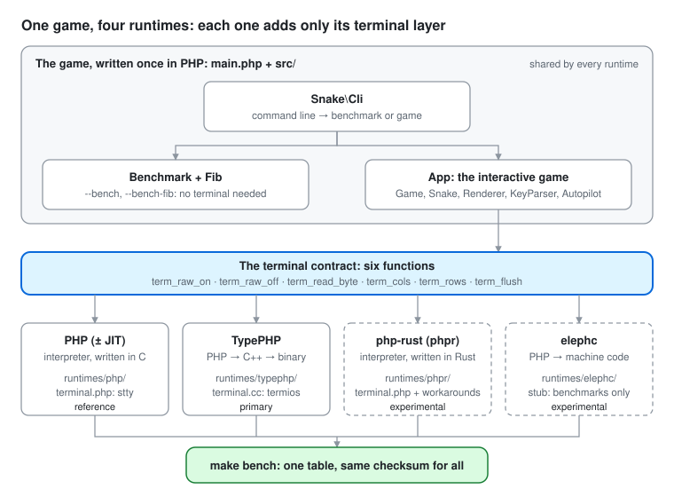

# Runtimes

The game in `src/` and `main.php` is plain PHP and is the same for every runtime. Each folder here holds only what one runtime needs on top of it: an entry point, the terminal layer, build settings and notes on what does not work there.

<p align="center"></p>

| Folder | Runtime | Status | Entry point |
|---|---|---|---|
| [`php/`](php/) | PHP interpreter (and the same file with OPcache JIT) | reference | `php runtimes/php/run.php` |
| [`typephp/`](typephp/) | [TypePHP](https://github.com/swoole/typephp): PHP → C++ → native binary | primary | `make build` → `./snake` |
| [`phpr/`](phpr/) | php-rust (`phpr`): a PHP interpreter written in Rust | experimental | `phpr runtimes/phpr/run.php` |
| [`elephc/`](elephc/) | [elephc](https://elephc.dev): PHP → native code, no Zend engine | experimental, benchmarks only | `make build-elephc` → `runtimes/elephc/snake` |

## The terminal contract

The game talks to the terminal through six functions, declared in [`typephp/native/terminal.stub.php`](typephp/native/terminal.stub.php):

```php
term_raw_on(): bool            // raw mode on; false when stdin is not a terminal
term_raw_off(): void
term_read_byte(int $timeoutMs): int   // one input byte, or -1 after the timeout
term_cols(): int
term_rows(): int
term_flush(): void
```

Every runtime implements them in its own `terminal.php` (TypePHP in C++). The headless benchmarks (`--bench`, `--bench-fib`) never call them, so a new runtime can join the comparison before its terminal layer exists.

## Rules

- **php is the reference.** It defines how the code must behave. PHPUnit and PHPStan run on it, and every runtime's benchmark checksum must match it (`make parity`).
- **php and TypePHP are primary**: CI must stay green for them, and the shared code may adapt to TypePHP's limits.
- **phpr and elephc are experimental**: CI checks elephc but does not block on it. The shared code is not changed for an experimental runtime; its gaps are worked around in its own folder or written down in its README.

When a runtime cannot handle some PHP feature, in this order:

1. If a workaround is harmless for every runtime, put it in the shared code (example: `(int) $grid[$i]` for TypePHP).
2. If it is about input, output or the system, put it in that runtime's `terminal.php` (example: phpr's output buffering).
3. If a primary runtime needs it and it would hurt the others, add a function to the terminal contract, the way the terminal itself is handled.
4. Otherwise mark it unsupported in that runtime's README.

## Adding a runtime

1. Create `runtimes/<name>/` with an entry point that calls `main($argc, $argv)` (or `Snake\Cli::run($argv)` if the runtime reserves `main()`, as elephc does) and a `terminal.php` (a stub is fine to start).
2. Add the runtime to `bench/runtimes.sh` (how to start it, its version, an install hint).
3. Run `bench/parity.sh <name>` until the checksums match, then `make bench`.
4. Write down what did not work in `runtimes/<name>/README.md`.
